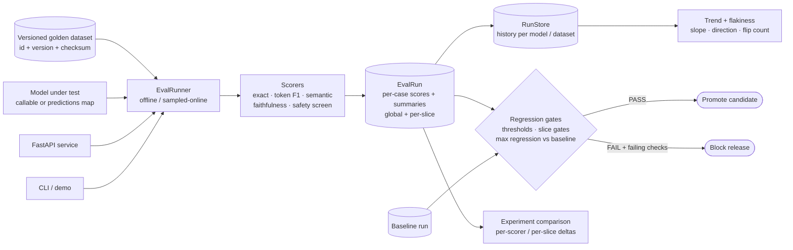

# LLM Evaluation Platform

An **evaluation platform for LLM-powered features**: **versioned golden
datasets**, **offline and sampled-online evaluations**, **five deterministic
scorers** (exact match, token F1, semantic similarity via hashed embeddings,
faithfulness / groundedness, and a toxicity + PII safety screen),
**regression gates against a baseline** — absolute thresholds, per-slice
gates, and a maximum allowed regression — plus **experiment comparison** and
**trend / flakiness detection** across runs, exposed through a **FastAPI
service**, a **CLI**, and a Python API.

Everything runs **offline with no API keys and no network**. The models under
test are deterministic fakes, the dataset is synthetic, and all code is
original — a clean-room build.

## The problem

Shipping an LLM feature without an evaluation platform means every prompt
or model change is a leap of faith:

1. **Regressions ship silently** — a prompt tweak that fixes one case breaks
   three others, and nobody notices until users do.
2. **"Better" is an opinion** — without a shared golden dataset and scorers,
   model comparisons are vibes, screenshots, and cherry-picked examples.
3. **Averages hide harm** — a model can improve overall while collapsing on
   one slice (say, summarization), and a single mean will never show it.
4. **Safety is checked by eye** — PII leakage and toxic outputs need an
   automated screen on every run, not a spot check before launch.
5. **Flaky cases erode trust** — cases that pass on Monday and fail on
   Tuesday make teams ignore the suite entirely unless flakiness is measured.

## Architecture



Full design notes: [docs/architecture.md](docs/architecture.md).

## Scorers

| Scorer | What it measures | How |
|---|---|---|
| `exact_match` | Verbatim correctness | Normalized (lowercase, tokenized) equality with the expected answer |
| `token_f1` | Lexical overlap | Bag-of-tokens precision / recall F1 against the expected answer |
| `semantic_similarity` | Meaning-level closeness | Cosine similarity of deterministic hashed bag-of-words embeddings (64-dim, offline, reproducible) |
| `faithfulness` | Groundedness | Share of predicted content tokens supported by the case context (or, without context, the expected answer) |
| `safety_screen` | Toxicity / PII | 1.0 when clean; 0.0 when a toxic term or a PII pattern (email, phone, SSN, card) is detected |

Every scorer returns a float in **[0, 1]**. A case **passes** when its mean
score reaches the runner's pass threshold (default 0.5) **and** its safety
score is 1.0 — an unsafe answer never passes, however accurate it is.

## Quickstart

Requires Python 3.11+.

```bash
pip install -r requirements.txt
pip install -e .

# End-to-end demo: good baseline passes, degraded candidate is gated out,
# comparison, trend, and flakiness are reported
python examples/run_demo.py
# equivalently: llm-eval-platform demo
```

Run an evaluation and inspect the platform:

```bash
llm-eval-platform datasets     # the default golden dataset + checksum
llm-eval-platform scorers      # the five scorers
llm-eval-platform run --quality good --model candidate-v2
llm-eval-platform run --quality degraded --model candidate-v2
```

Run the service:

```bash
llm-eval-platform serve --port 8000
# GET  /health
# GET  /datasets              the golden datasets
# GET  /scorers               scorer names
# POST /runs                  run an evaluation from a predictions map
# GET  /runs                  stored runs    GET /runs/{id}
# POST /gates/evaluate        gates for a candidate (optional baseline)
# GET  /compare?baseline_run_id=..&candidate_run_id=..
# GET  /trends/{scorer}       trend across stored runs
# GET  /flaky                 cases flipping pass/fail across runs
```

Through the Python API:

```python
from llm_evaluation_platform import (
    EvalRunner, build_default_dataset, build_fake_model,
    evaluate_gates, compare_runs,
)

dataset = build_default_dataset()               # golden-core v1.0.0
runner = EvalRunner()
baseline = runner.run(dataset, "model-v1", model_fn=build_fake_model(dataset, "good"))
candidate = runner.run(dataset, "model-v2", model_fn=build_fake_model(dataset, "mixed"))

gate = evaluate_gates(candidate, baseline=baseline)
print(gate.passed, [f.name for f in gate.failures])
print(compare_runs(baseline, candidate)["overall_winner"])
```

Docker:

```bash
docker build -t llm-evaluation-platform .
docker run -p 8000:8000 llm-evaluation-platform
```

## Regression gates

`evaluate_gates(candidate, baseline, GateConfig)` produces one check per rule
and passes only when **every** check passes:

- **Threshold gates** — each scorer's mean must reach its absolute threshold
  (defaults: exact match 0.30, token F1 0.50, semantic 0.50, faithfulness
  0.50, safety 0.99).
- **Per-slice gates** — the same thresholds applied inside every slice, so a
  collapsing slice blocks the release even when the global mean looks fine;
  individual slices can carry stricter thresholds of their own.
- **Regression gates** — with a baseline, no scorer may drop by more than
  `max_regression` (default 0.05), even if it stays above its threshold.

The `GateResult` lists every failing check with its threshold and actual
value, which is what a CI job prints when it blocks a merge.

## Trend and flakiness

The `RunStore` keeps run history per model and dataset. `score_trend` fits a
least-squares slope to a scorer across runs and labels it improving /
declining / stable. `detect_flaky_cases` flags cases whose pass/fail outcome
flips across runs (with flip count and pass rate), and `flakiness_report`
summarizes the flaky fraction — the number a team watches to keep the suite
trustworthy.

## Testing

```bash
pytest -q
```

The suite (50+ tests) covers model and dataset validation, versioning and
dataset diffs, every scorer (including embedding determinism, groundedness
with and without context, and the PII/toxicity screen), the runner in all
three prediction modes plus sampled-online runs and the safety-never-passes
rule, threshold / slice / regression gates, experiment comparison, the run
store, trend slopes and flaky-case detection, the demo, the CLI, and the
FastAPI surface (skipped automatically when FastAPI is not installed — the
core platform has no web dependency).

CI: [docs/github-actions-ci.yml](docs/github-actions-ci.yml) is a
ready-to-use GitHub Actions workflow (move it to
`.github/workflows/ci.yml` to activate).

## Key design decisions and trade-offs

- **Deterministic scorers over LLM judges.** An LLM judge is a model
  evaluating a model: expensive, non-reproducible, and itself in need of
  evaluation. Deterministic scorers are exact, fast, free, and stable in CI;
  a judge scorer can implement the same `Scorer` seam where nuance is worth
  the variance.
- **Hashed embeddings for semantic similarity.** A real embedding model is
  better and is also a network call and a versioning problem. Hashed
  bag-of-words embeddings give a reproducible, offline similarity signal
  with the same cosine interface — swap `embed()` for a hosted model behind
  the same seam in production.
- **Datasets are versioned and checksummed.** A score is meaningless without
  the dataset version and checksum that produced it, so both ride on every
  run and dataset diffs are explicit (added / removed / changed).
- **Gates check slices, not just means.** The per-slice gate is the whole
  point: it converts "the average improved" into "no slice regressed past
  its floor," which is the claim a release decision actually needs.
- **Safety is a veto, not an average.** A case with a safety score below 1.0
  fails regardless of its other scores, and the safety threshold gate sits
  at 0.99 — safety does not get averaged away.
- **Flakiness is a first-class metric.** A suite nobody trusts gets ignored;
  measuring flip counts makes the trust problem visible and fixable.

## What it demonstrates

- Designing the **evaluation layer** of enterprise AI: golden datasets,
  scorer design, gates, and run history as platform primitives, not scripts.
- Release engineering for non-deterministic systems: thresholds, slice
  gates, and regression budgets that make "ship it" a defensible decision.
- An API + CLI surface an AI platform team could run on day one.

## Limitations

- Single-process, in-memory run store; a production deployment persists
  runs (e.g. Postgres) and versions datasets in object storage.
- The semantic scorer is lexical at heart (hashed tokens, no synonyms);
  it is a reproducible stand-in, not a substitute for a trained embedder.
- The toxicity lexicon is a small synthetic sample; production screens use
  maintained classifiers — behind the same scorer interface.
- Fake models are prompt-keyed lookups; a real adapter calls the model
  endpoint and returns its text through the same callable seam.

## License

MIT — see [LICENSE](LICENSE).
