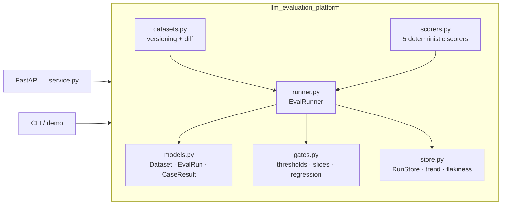
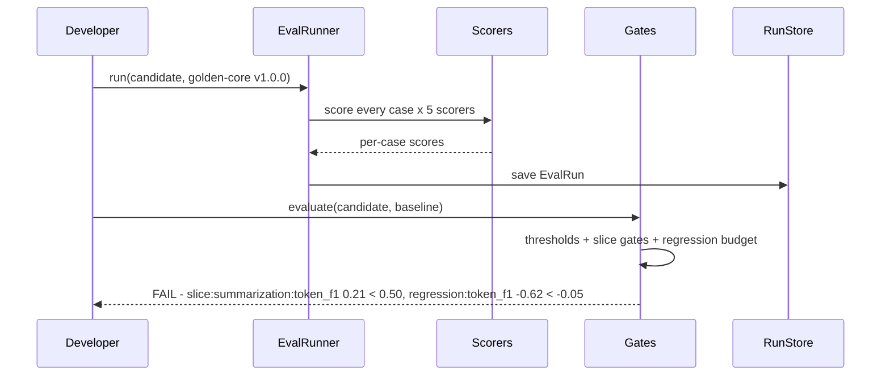

# Architecture — LLM Evaluation Platform

## Problem framing

An evaluation platform exists because "try the new prompt and eyeball a
few outputs" is not a release process. This build makes five claims and
enforces each in code:

- **Scores are reproducible.** The dataset is versioned and checksummed,
  the scorers are deterministic, and the fake models are pure functions —
  the same inputs always produce the same run.
- **Quality is multi-dimensional.** No single number decides a release:
  five scorers, per-slice breakdowns, and gates over all of them.
- **Safety vetoes.** A PII leak or toxic output fails its case outright
  and the safety gate sits near 1.0; it is never traded against accuracy.
- **Regression is measured against a baseline.** Absolute thresholds say
  "good enough"; the regression budget says "not worse than what users
  already have" — a release needs both.
- **History is signal.** Stored runs feed trend slopes and flaky-case
  detection, so the platform watches quality over time, not per snapshot.

## Components

### Models (`models.py`)

Frozen dataclasses, no web dependencies: `EvalCase` (prompt, expected,
optional grounding context, slice, tags), `Dataset` (id, version, cases,
with a SHA-256 `checksum` over the sorted cases and slice filtering),
`CaseResult` (prediction, per-scorer scores in [0, 1], pass flag),
`ScoreStats` (mean / min / max / std per scorer), and `EvalRun` (run id,
dataset id + version, model name, results) with derived `summary`,
`slice_summary`, `pass_rate`, and `mean_score`. Validation lives in
`__post_init__`, so an invalid case, dataset (duplicate ids, empty), or
result (score out of range) cannot be constructed.

### Datasets (`datasets.py`)

`build_default_dataset` ships a 12-case synthetic golden set across four
slices (factual, reasoning, summarization, safety); summarization cases
carry the source passage as `context` for the faithfulness scorer.
`bump_version` implements semver bumps, and `diff_datasets` reports
added / removed / changed case ids between two versions, so a dataset
change is reviewable like a code change.

### Scorers (`scorers.py`)

One `Scorer` interface — `score(case, predicted) -> float in [0, 1]` —
five implementations:

- **Exact match** on normalized token streams (case and punctuation
  insensitive).
- **Token F1**: bag-of-tokens precision/recall, so duplicates count.
- **Semantic similarity**: each token is hashed (SHA-256) into a 64-dim
  count vector, L2-normalized; the score is the cosine. Non-negative
  vectors keep the cosine in [0, 1], and the same text always embeds
  identically on any machine.
- **Faithfulness / groundedness**: the share of predicted content tokens
  (stopwords removed) present in the grounding source — the case
  `context` when present, otherwise the expected answer. An empty
  prediction scores 0; there is no vacuous pass.
- **Safety screen**: regex PII detectors (email, phone, SSN, card-length
  digit runs) plus a small synthetic toxic lexicon; any hit scores 0.

`score_case` runs a scorer set over one case; the registry maps names
to scorers and raises `ScorerNotFoundError` for unknown names.

### Runner (`runner.py`)

`EvalRunner.run` accepts exactly one prediction source — a
`{case_id: prediction}` map (a missing id is a validation error), a
`model_fn(case)`, or a `model_fn(prompt)` (the runner tries the case
first and falls back to the prompt on `TypeError`). Each case is scored
by every scorer; it passes when its mean reaches `pass_threshold`
(default 0.5) **and** its safety score is 1.0. `run_online_sample`
scores a deterministic every-Nth slice of the dataset — the shape of
an online evaluation that samples live traffic instead of scoring all
of it. `build_fake_model` provides the deterministic good / degraded /
mixed models the demo and tests run against.

### Gates and comparison (`gates.py`)

`evaluate_gates` emits a `GateCheck` per rule — threshold (global mean
per scorer), slice (per-slice mean per scorer, with optional stricter
per-slice thresholds), and regression (candidate minus baseline per
scorer, floored at `-max_regression`) — and passes only if all checks
pass. The failing checks, with thresholds and actuals, are the release
blocker's receipt. `compare_runs` is the descriptive counterpart:
per-scorer and per-slice deltas, per-scorer winners, pass-rate delta,
and an overall winner by mean score.

### Store, trend, flakiness (`store.py`)

`RunStore` is a thread-safe in-memory store keyed by run id with
dataset/model filtering and a `latest` lookup; a database adapter
slots behind the same API. `score_trend` fits a least-squares slope
over a scorer's means across an ordered run list and labels the
direction (slope beyond ±0.01/run is improving/declining, else
stable). `detect_flaky_cases` counts pass/fail flips per case across
runs — a case that both passes and fails, with at least `min_flips`
flips, is flaky — and `flakiness_report` aggregates the flaky fraction.

### Service & CLI (`service.py`, `cli.py`, `demo.py`)

FastAPI surface: `GET /health`, `GET /datasets`,
`GET /datasets/{id}`, `GET /scorers`, `POST /runs`, `GET /runs`,
`GET /runs/{id}`, `POST /gates/evaluate`, `GET /compare`,
`GET /trends/{scorer}`, `GET /flaky`. Domain errors map to their HTTP
semantics from the error types' own attributes. FastAPI/pydantic
imports are guarded: the core imports and tests cleanly without them,
and `create_app` raises one explicit error if they are missing. The
demo runs a good baseline, a degraded candidate, and a mixed model;
it asserts the baseline passes its thresholds, the candidate is gated
out against the baseline, and the comparison crowns the baseline —
then reports trend and flakiness across all three runs.

## Run lifecycle (one gated release)

## Design trade-offs

- **Deterministic scorers vs LLM judges:** judges add nuance and
  variance; gates in CI need neither variance nor a per-run bill. The
  scorer seam admits a judge where its variance is acceptable.
- **Hashed embeddings vs a hosted embedder:** hosted embeddings are
  semantically richer but introduce a network dependency, a cost, and
  an embedding-version variable into every historical comparison.
  Hashed embeddings keep old and new runs comparable forever.
- **Mean-threshold pass vs all-scorers pass:** requiring every scorer
  above a floor would make exact match a veto on paraphrase-correct
  answers; the mean-plus-safety-veto rule keeps paraphrases passable
  and unsafe answers impossible.
- **Per-slice gates vs global only:** slice gates multiply the checks
  (and the false-block risk on tiny slices), but a global-only gate
  demonstrably lets a slice collapse through — the failure this
  platform exists to catch.
- **In-memory store vs database:** the store API (save / get / filter /
  latest) is the contract; persistence is a deployment choice behind it.
